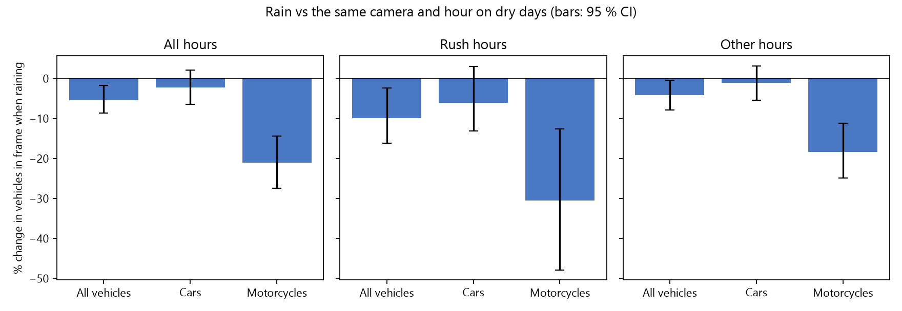
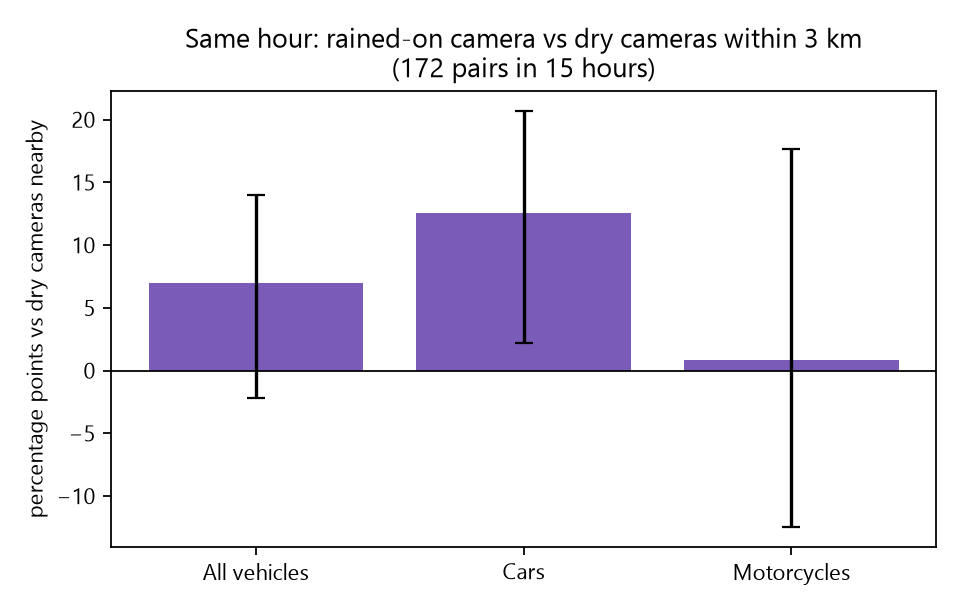
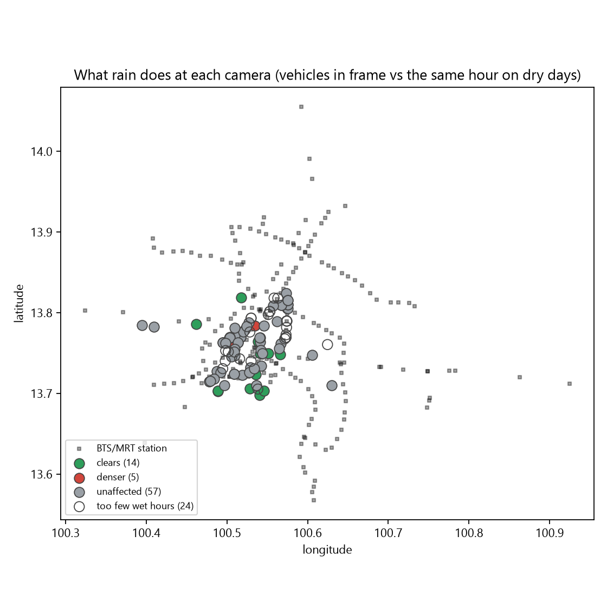
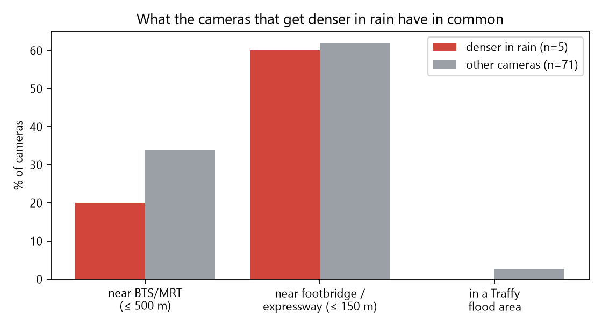
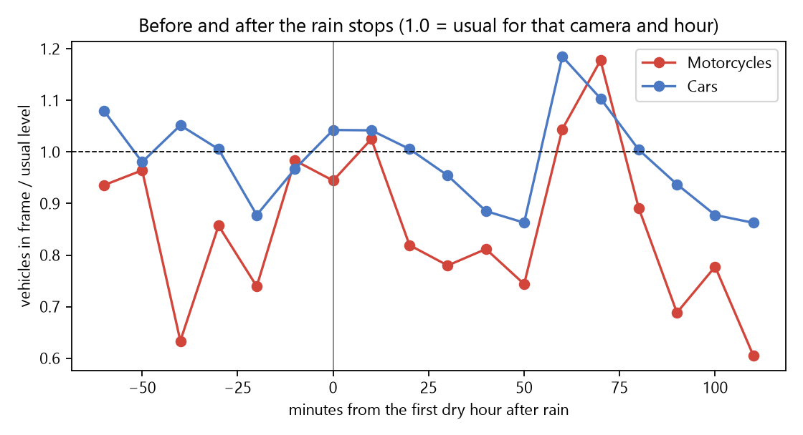
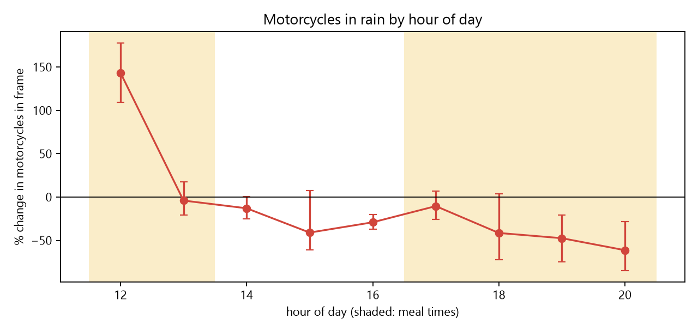
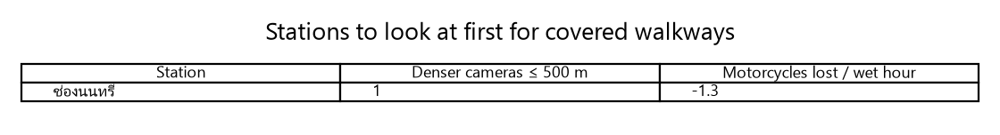

# Rain Insight — does rain change Bangkok traffic?

100 BMA cameras, 25–31 Aug 2026, one frame every ~10 min, 06:00–21:00. Rain = ≥ 1 mm in the hour at the camera's
nearest DDS rain gauge (129 gauges; median 841 m away). Each rainy hour is compared with **the same camera, the same
hour of day, on dry days of the same kind (weekday vs weekend)**.

## Rebuild

```bash
python DataAnalysis/rain/recount.py        # ~1 h on GPU: best.pt, conf 0.30 -> DataAnalysis/data/counts_v2.csv, boxes_v2.csv
python DataAnalysis/rain/run_all.py        # result tables -> DataAnalysis/output/*.csv
python DataAnalysis/rain/shelter.py        # stationary motorcycles near footbridges/expressways
python -m DataAnalysis.rain.figures        # figures -> DataAnalysis/figures/*.png
```
`DataAnalysis/rain_insight.ipynb` shows the figures and the main tables. Tests: `python -m unittest discover -s tests/rain -t .`

## Results (counts from best.pt @ conf 0.30, 293 rainy camera-hours on 94 cameras)

| | Change in vehicles in frame when raining | 95 % CI |
|---|---|---|
| All vehicles | **−5.4 %** | −8.7 % to −1.8 % |
| Cars | −2.2 % | −6.4 % to +2.2 % (no clear change) |
| **Motorcycles** | **−21.0 %** | −27.4 % to −14.4 % |
| Motorcycles, rush hours | −30.5 % | −47.8 % to −12.6 % |



- **Motorcycles drop by about a fifth in rain; cars barely change.** This is the robust finding.
- **Weekend trap (fixed):** 485 of 554 rainy camera-hours fell on Sat 29 / Sun 30 Aug, when traffic is ~22 % lower
  anyway. A baseline that ignored weekday/weekend gave −17 % (all) and −44 % (motorcycles); those numbers mostly measured
  the weekend and must not be quoted.
- **Same hour, rained-on vs dry cameras within 3 km** (`natural_experiment.png`, 172 pairs in 15 hours): all vehicles
  +7 pts (CI −2 to +14), cars **+12.6 pts (CI +2.2 to +20.7)**, motorcycles +1 pt (CI −12 to +18). Within the same hour,
  rained-on cameras do not have fewer motorcycles than dry ones nearby — so the motorcycle drop looks like a city-wide
  response to rainy weather (people deciding not to ride) rather than something local to where the rain falls. Cars
  being *higher* at rained-on cameras in the same hour fits people switching to cars/taxis, but rests on 15 hours.

  
- **Per camera** (`camera_map.png`, labels need ≥ 3 rainy hours and a CI that excludes 0): 14 cameras clearly emptier,
  **5 clearly denser**, 57 no clear change, 24 too few rainy hours.

  
- **What the denser cameras share** (`denser_share.png`): nothing clear — near BTS/MRT 20 % vs 34 % of others, near a
  footbridge/expressway 60 % vs 62 %, in a flood area 0 % vs 3 %. With only 5 denser cameras the CIs are wide.
  The hypotheses "denser near stations" (②) and "denser near shelters" (①) are not supported by this data.

  
- **Sheltering motorcycles (①, `shelter.py`):** at the 56 cameras near a footbridge/expressway that saw rain, 2.5 % of
  motorcycle boxes are stationary on dry hours vs 2.8 % in rain — no meaningful difference; 12 of 56 cameras rose. The
  top "pairs" (`figures/pair_*.png`) show bikes parked on the pavement, and one "dry" frame has a visibly wet road (its gauge
  is ~800 m away). They are **not** evidence of sheltering and should not go on a slide as such.
- **Flood areas (③):** Traffy has 710 flood complaints (38 clusters), but only 2 cameras are within 100 m of one —
  complaints come from side streets, cameras watch main roads. ③ cannot be tested with these cameras.
  `flood_sensor_hours.csv` lists the 13 sensor-hours ≥ 5 cm (sensors have no coordinates) for case studies.
- **After the rain stops** (`rebound.png`, ~150 rain ends): motorcycles stay below their usual level for the next two
  hours (ratio ~0.6–0.9, one spike at +60–70 min), cars stay near usual. No clear surge — trips look **cancelled rather
  than delayed**. Rain timing is hourly, so "rain end" is only known to the hour.

  
- **Meal times (indirect rider test, `mealtime.png`):** no consistent pattern. The drop is small at 13:00 (−4 %) and
  17:00 (−10 %), but largest at 18:00–20:00 (−41 % to −61 %), which are meal times too; several hours rest on < 15 cameras
  (12:00 on 3). The data neither supports nor rules out "riders keep riding in rain".

  
- **Policy list** (`policy_stations.png`): only one station (ช่องนนทรี) is within 500 m of a denser camera, and
  motorcycles there *rose* in rain. The data does not single out stations for covered walkways; the case for them rests
  on the city-wide motorcycle drop instead.

  

## Caveats

- One week, one rainy weekend: most rainy hours are Sat/Sun afternoons. Weekday rain: 69 camera-hours only.
- Still frames measure how full the road is (vehicles in frame), not speed or flow.
- Detector: 81 % count accuracy on the hand-checked test set, equally good in rain (14 rainy test frames: 105 % vs 106 %
  of vehicles found); motorcycles are found at ~98 %.
- Riders vs private motorcycles and taxis vs private cars cannot be told apart at 352×288.
