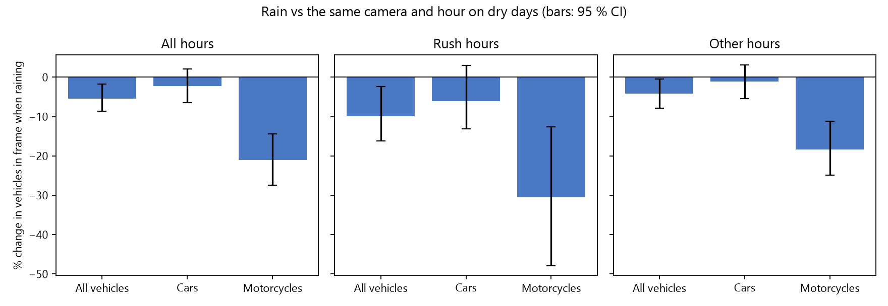
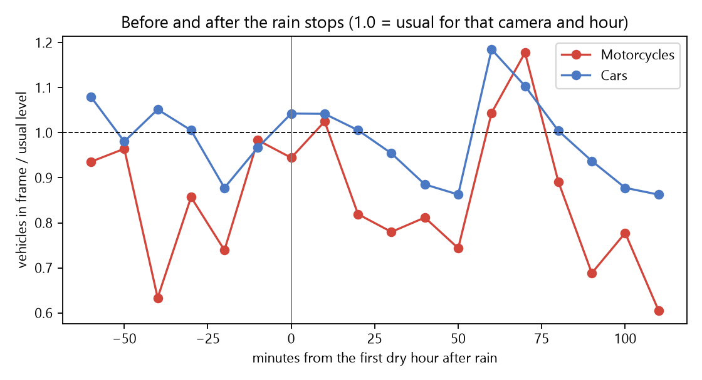
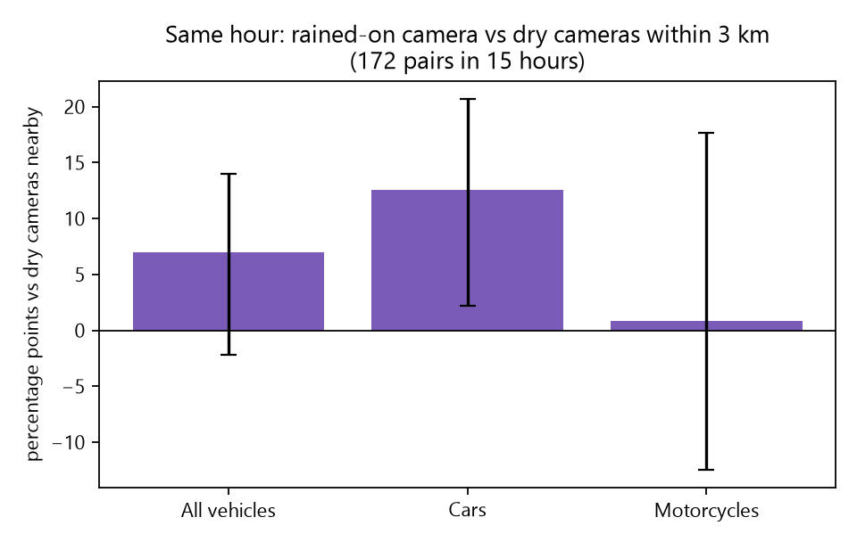
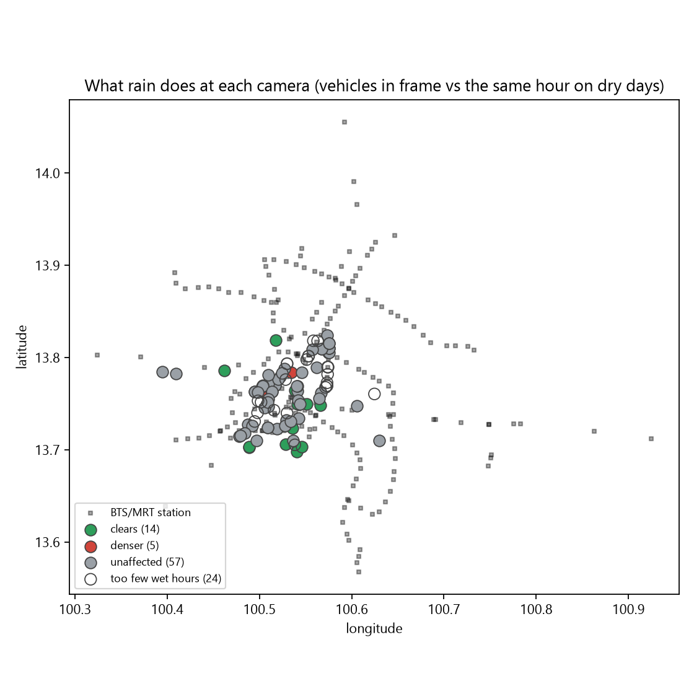
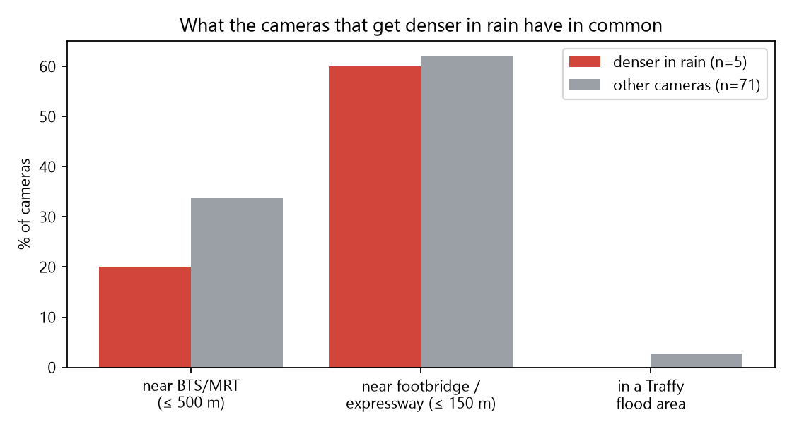

# สรุปผล: ฝนตกเปลี่ยนการเดินทางในกรุงเทพฯ อย่างไร

ข้อมูล: กล้อง BMA 100 ตัว, 25–31 ส.ค. 2569, ภาพทุก ~10 นาที, 06:00–21:00 (60,721 ภาพ ตัดภาพกล้องค้างแล้ว)
รายละเอียดวิธีรันและตัวเลขทั้งหมด: [README.md](README.md)

## ประโยคเดียวที่ควรจำ

> **ฝนตกแล้วมอไซค์บนถนนหายไปราว 1 ใน 5 ส่วนรถยนต์แทบไม่เปลี่ยน และคนส่วนใหญ่ "ยกเลิก" การเดินทาง ไม่ได้รอฝนหยุด**

## วิธีวัด

1. **นับรถใหม่ทุกภาพ** ด้วยโมเดลล่าสุด (`Models/weights/best.pt`, train ด้วย label คนครบ 1,200 ภาพ) ที่ conf 0.30
   ซึ่งเลือกจากชุด val ที่คนตรวจ — บนชุด test นับแม่น ~81% และแม่นเท่ากันตอนฝนตก (เจอรถ 105% vs 106%)
2. **ฝน** = ≥ 1 มม. ในชั่วโมงนั้น ที่สถานีวัดฝน DDS ที่ใกล้กล้องที่สุด (129 สถานี, ห่างเฉลี่ย ~841 ม.)
3. **เทียบกับ "ปกติ"** = กล้องเดียวกัน ชั่วโมงเดียวกัน ในวันที่ไม่มีฝน **ประเภทเดียวกัน (วันธรรมดา / วันหยุด)**
4. **ช่วงความเชื่อมั่น 95%** ด้วย bootstrap สุ่มทั้งกล้อง (ไม่สุ่มทีละชั่วโมง เพราะชั่วโมงของกล้องเดียวกันคล้ายกัน)

## ผลหลัก

| รถในภาพตอนฝนตก เทียบกับปกติ | เปลี่ยน | 95% CI |
|---|---|---|
| **มอไซค์** | **−21%** | −27% ถึง −14% |
| มอไซค์ ช่วงเร่งด่วน (07–09, 17–20) | −31% | −48% ถึง −13% |
| รถยนต์ | −2% | −6% ถึง +2% (ไม่เปลี่ยนชัดเจน) |
| รถทั้งหมด | −5% | −9% ถึง −2% |

### ⚠️ กับดักวันหยุด (แก้แล้ว)

ฝน **88%** ของสัปดาห์ (485 จาก 554 กล้อง-ชั่วโมง) ตก **เสาร์ 29 – อาทิตย์ 30 ส.ค.** ซึ่งวันหยุดมีรถน้อยกว่าวันธรรมดาอยู่แล้ว ~22%
ถ้าไม่แยกวันหยุดออก จะได้ **−17% / −44%** ซึ่ง**ผิด** (วัดผลของวันหยุด ไม่ใช่ฝน) — **ห้ามใช้ตัวเลขชุดนั้นในรายงาน**
เรื่องนี้ควรเล่าในรายงานด้วย: แสดงว่าทีมตรวจตัวแปรกวนแล้ว

## ข้อค้นพบอื่น

**หลังฝนหยุด มอไซค์ไม่ได้พุ่งกลับมา** — ยังต่ำกว่าปกติอีก ~2 ชั่วโมง (เฉลี่ยจากการหยุดของฝน ~150 ครั้ง)
→ คน **ยกเลิก** การเดินทาง ไม่ได้รอฝนหยุดแล้วค่อยออก (ข้อมูลฝนเป็นรายชั่วโมง จึงรู้เวลาฝนหยุดแค่ระดับชั่วโมง)

**เทียบกล้องข้าง ๆ ในชั่วโมงเดียวกัน** (กล้องที่โดนฝน vs กล้องแห้งในรัศมี 3 กม., 172 คู่ใน 15 ชั่วโมง)
- มอไซค์: +1 จุด (ไม่ต่างกัน) → มอไซค์ลดลง **ทั่วเมือง** ตอนอากาศเป็นฝน ไม่ใช่เฉพาะจุดที่ฝนตก
- **รถยนต์: +12.6 จุด** (CI +2 ถึง +21) → เข้ากับสมมติฐานที่คนหันไปใช้รถยนต์/แท็กซี่ตรงที่ฝนตก แต่ข้อมูลมีแค่ 15 ชั่วโมง

**รายกล้อง**: โล่งขึ้นชัดเจน 14 ตัว · **แน่นขึ้นชัดเจนแค่ 5 ตัว** · ไม่ต่างชัด 57 ตัว · ฝนตกน้อยเกินจะสรุป 24 ตัว

## สมมติฐานจากไดอะแกรมของทีม

| สมมติฐาน | ผล | หลักฐาน |
|---|---|---|
| ① มอไซค์จอดหลบใต้สะพาน กินเลนซ้าย | ❌ ไม่เจอ | กล้องใกล้สะพาน 56 ตัว: มอไซค์จอดนิ่ง 2.5% (แห้ง) vs 2.8% (ฝน) |
| ② คนไป BTS/MRT แท็กซี่ไปออหน้าสถานี | ❌ ไม่เจอ | กล้องที่แน่นขึ้นใกล้สถานี 20% vs กล้องอื่น 34% |
| ③ น้ำท่วม → มอไซค์หนีเข้าเลนกลาง | ทดสอบไม่ได้ | เรื่องร้องเรียนน้ำท่วม Traffy 710 เรื่อง อยู่ใกล้กล้อง (100 ม.) แค่ 2 ตัว — ร้องเรียนจากซอย แต่กล้องอยู่ถนนใหญ่ |
| ไรเดอร์ยังวิ่งตอนฝนตก | สรุปไม่ได้ | ภาพ 352×288 แยกไรเดอร์ไม่ได้ · รูปแบบตามเวลาอาหารไม่สม่ำเสมอ |

## ข้อเสนอเชิงนโยบาย (สำหรับรายงาน)

- ข้อมูล**ชี้สถานีเฉพาะไม่ได้** (มีกล้องแน่นขึ้นใกล้สถานีแค่ 1 สถานี และมอไซค์ที่นั่นกลับเพิ่มขึ้น)
- เสนอให้อิงจาก **"มอไซค์หายไป 21% ทั่วเมือง (31% ช่วงเร่งด่วน) และไม่กลับมาหลังฝนหยุด"** = มีการเดินทางจำนวนมากที่หายไปเพราะฝน
  ทางเดินมีหลังคาจากซอยถึงสถานีคือสิ่งที่ทำให้คนกลุ่มนี้ยังเดินทางได้ โดยไม่ต้องเปลี่ยนไปเรียกรถ

## ข้อจำกัดที่ต้องเขียนในรายงาน

- ข้อมูล 1 สัปดาห์ ฝนส่วนใหญ่ตกวันหยุด (ฝนวันธรรมดามีแค่ 69 กล้อง-ชั่วโมง)
- ภาพนิ่งวัดได้แค่ "ถนนแน่นแค่ไหน" ไม่ได้วัดความเร็วหรือปริมาณรถที่ผ่าน
- สถานีวัดฝนห่างกล้องเฉลี่ย ~841 ม. บางภาพที่นับว่า "แห้ง" ถนนยังเปียกอยู่
- แยกไรเดอร์ / แท็กซี่ ออกจากรถส่วนตัวไม่ได้ที่ความละเอียดนี้

## ไฟล์ที่เกี่ยวข้อง

- โค้ด: `DataAnalysis/rain/` (รันซ้ำ: `recount.py` → `run_all.py` → `shelter.py` → `python -m DataAnalysis.rain.figures`)
- ตารางผล: `DataAnalysis/output/*.csv` · ภาพ: `DataAnalysis/figures/*.png` · notebook: `DataAnalysis/rain_insight.ipynb`
