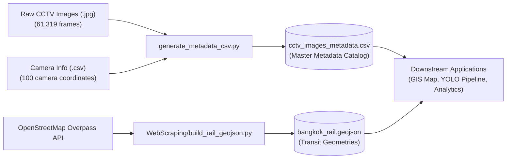

# Data Engineering & Extraction Pipelines (`DataEngineering/`)

This directory contains the data engineering pipelines responsible for automated dataset ingestion, spatial-temporal cataloging, geospatial extraction, and data standardization.

---

## 📁 Pipeline Components

```text
DataEngineering/
├── dataset_downloader.py        # Automated dataset retriever from Google Drive
├── generate_metadata_csv.py     # Parser & catalog generator for all CCTV frames
├── build_rail_geojson.py        # Backward-compatible proxy to rail extractor
├── cctv_images_metadata.csv     # Master tabular catalog (61,319 records, 27 fields)
└── WebScraping/                 # Geospatial and web extraction modules
    ├── README.md                # Web extraction documentation
    └── build_rail_geojson.py    # OpenStreetMap transit alignment extractor
```

---

## 🛠️ Data Engineering Workflows

### 1. Automated Dataset Ingestion (`dataset_downloader.py`)
Fetches and unpacks the official BMA traffic camera image archive from remote cloud storage without requiring authentication keys.
```bash
python DataEngineering/dataset_downloader.py
```
- Validates local directory structures (`dataset/100_cameras/cctv_images/` and `cctv_info.csv`).
- Automatically resolves missing dependencies (such as `gdown`) when invoked.
- Verifies sample frame integrity across camera directories.

### 2. Spatial-Temporal Metadata Generation (`generate_metadata_csv.py`)
Scans all 61,319 image files across the 100 camera folders, parsing Thai filename naming conventions, GPS coordinates, capture dates, and microsecond-level timestamps into a standardized CSV catalog.
```bash
python DataEngineering/generate_metadata_csv.py
```
- Output: `DataEngineering/cctv_images_metadata.csv`

### 3. Rapid Transit Geospatial Extraction (`WebScraping/build_rail_geojson.py`)
Queries OpenStreetMap Overpass servers to download track vectors and station coordinates for Bangkok's BTS and MRT lines, creating a unified GeoJSON layer for spatial correlation.
```bash
python DataEngineering/WebScraping/build_rail_geojson.py
```
- Output: `Apps/Camera-Map/static/bangkok_rail.geojson`

---

## 📊 Master Metadata Schema (`cctv_images_metadata.csv`)

The catalog contains 61,319 rows indexed by `image_id` with 27 attributes:

| Column Category | Field Names | Description |
| :--- | :--- | :--- |
| **Identifiers** | `image_id`, `camera_id`, `filename`, `relative_path` | Unique primary keys and filesystem paths. |
| **Spatial Data** | `location_th`, `direction_th`, `location_en`, `location_detail_en`, `latitude`, `longitude`, `ip_address` | Intersection names, directional labels, and WGS84 GPS coordinates. |
| **Temporal Data** | `timestamp`, `date`, `time`, `year`, `month`, `day`, `day_of_week`, `is_weekend`, `hour`, `minute`, `second` | Parsed ISO timestamps and calendar components for temporal grouping. |
| **Time Period** | `time_period` | Categorized traffic phase: `Early Morning`, `Morning Rush`, `Midday`, `Evening Rush`, `Night`. |
| **Image Specs** | `width`, `height`, `aspect_ratio`, `file_size_bytes` | Pixel dimensions ($352 \times 288$ CIF standard), aspect ratio (1.22), and storage footprint. |

---

## 🔄 Data Architecture


