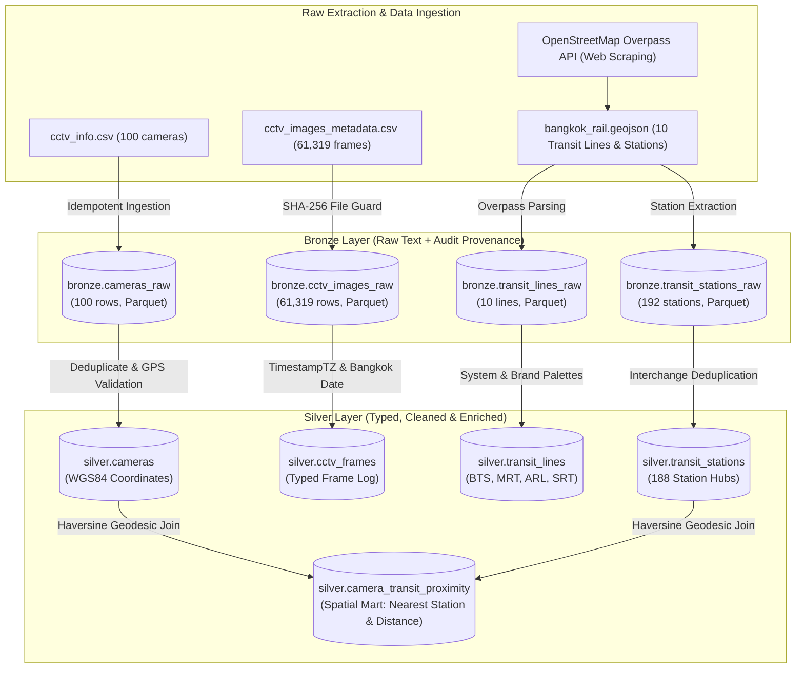

# Data Engineering & Lakehouse Pipelines (`DataEngineering/`)

This directory houses the end-to-end Data Engineering architecture for the Bangkok CCTV Analysis platform, implementing an ACID-compliant two-layer Lakehouse (Bronze $\rightarrow$ Silver) using **PyDuckLake** and storage-optimized **Apache Parquet** files.

---

## 📁 Pipeline Architecture & Structure

```text
DataEngineering/
├── lakehouse_pipeline.py        # End-to-end PyDuckLake Lakehouse orchestrator
├── dataset_downloader.py        # Automated dataset retriever from Google Drive
├── generate_metadata_csv.py     # Parser & catalog generator for all CCTV frames
├── build_rail_geojson.py        # Backward-compatible proxy to rail extractor
├── cctv_images_metadata.csv     # Master tabular catalog (61,319 records, 27 fields)
├── lakehouse/                   # Lakehouse database storage
│   ├── bkk_cctv.ducklake        # PyDuckLake catalog database
│   └── data/                    # Physical Parquet data files (Bronze & Silver partitions)
└── WebScraping/                 # Geospatial and web extraction modules
    ├── README.md                # Web extraction documentation
    └── build_rail_geojson.py    # OpenStreetMap transit alignment extractor (BTS/MRT/ARL/SRT)
```

---

## 🏗️ Two-Layer Lakehouse Architecture (PyDuckLake)



### 1. Bronze Layer (Raw Ingestion)
- **Lossless Ingestion**: Retains every incoming field as raw text to preserve exact original representation.
- **Audit Columns**: Every bronze record is enriched with:
  - `source_file`: Origin file name.
  - `source_row_number`: 1-based index within the source file.
  - `file_sha256`: Cryptographic hash for idempotency and duplicate load prevention.
  - `ingested_at`: Microsecond-precision ingestion timestamp (`TimestampTZ` in Bangkok time).

### 2. Silver Layer (Cleaned & Enriched)
- **Strong Typing**: Values converted with `TRY_CAST` into native types (`Double`, `Integer`, `BigInt`, `Date`, `TimestampTZ`).
- **Data Quality**: Validates geographic coordinate boundaries, trims whitespace, standardizes timestamps to `Asia/Bangkok`.
- **Deduplication**: Enforces single record per primary key using `QUALIFY ROW_NUMBER() OVER (...) = 1`.
- **Spatial Intelligence Mart (`silver.camera_transit_proximity`)**: Computes spherical Haversine geodesic distance in meters from each CCTV camera to all Bangkok transit stations, tagging nodes within a 500-meter walk shed (`is_near_transit = TRUE`).

---

## 🚀 Running the Pipeline

Execute the full end-to-end pipeline with a single command:

```bash
# Standard execution (idempotent, uses file guards)
python DataEngineering/lakehouse_pipeline.py

# Complete rebuild from scratch
python DataEngineering/lakehouse_pipeline.py --reset

# Force re-ingestion bypassing file guards
python DataEngineering/lakehouse_pipeline.py --force
```

### Verified Pipeline Output

| Table | Layer | Row Count | Description |
| :--- | :--- | :---: | :--- |
| `bronze.cameras_raw` | Bronze | 100 | Raw BMA camera coordinates and street descriptions |
| `bronze.cctv_images_raw` | Bronze | 61,319 | Raw image metadata with parsed filenames |
| `bronze.transit_lines_raw` | Bronze | 10 | BTS, MRT, ARL, and SRT route geometries from OSM |
| `bronze.transit_stations_raw` | Bronze | 192 | Raw station nodes and interchange connections |
| `silver.cameras` | Silver | 100 | Validated camera nodes with coordinate bounds |
| `silver.cctv_frames` | Silver | 61,319 | Typed frame catalog with temporal attributes |
| `silver.transit_lines` | Silver | 10 | Rapid transit lines with official brand colors |
| `silver.transit_stations` | Silver | 188 | Deduplicated station nodes with interchange tags |
| `silver.camera_transit_proximity` | Silver | 100 | Nearest transit station and walking distance in meters |

---

## 🚆 Rapid Transit Coverage (BTS / MRT / ARL / SRT)

The extraction module (`DataEngineering/WebScraping/build_rail_geojson.py`) queries the OpenStreetMap Overpass API for all Bangkok rapid rail systems:
1. **BTS Sukhumvit Line** (`#65B724`, Green)
2. **BTS Silom Line** (`#02817D`, Dark Green)
3. **BTS Gold Line** (`#A58704`, Gold Monorail)
4. **MRT Blue Line** (`#1E398D`, Blue Loop Line)
5. **MRT Purple Line** (`#893B90`, Purple Line)
6. **MRT Yellow Line** (`#FFD400`, Yellow Monorail)
7. **MRT Pink Line** (`#E76589`, Pink Monorail)
8. **Airport Rail Link (ARL)** (`#91278F`, Suvarnabhumi Airport Link)
9. **SRT Dark Red Line** (`#B81D24`, Bang Sue - Rangsit)
10. **SRT Light Red Line** (`#E83D3D`, Bang Sue - Taling Chan)

---

## 🔍 Querying the Lakehouse

Downstream data science and dashboard scripts can query the lakehouse directly using DuckDB or PyDuckLake:

```python
import duckdb

con = duckdb.connect()
# Attach PyDuckLake catalog
con.execute("ATTACH 'DataEngineering/lakehouse/bkk_cctv.ducklake' AS lake (TYPE ducklake)")

# Find CCTV cameras closest to mass transit stations
df = con.execute("""
    SELECT
        camera_id, camera_name_th, nearest_station_th, transit_system, distance_meters
    FROM lake.silver.camera_transit_proximity
    WHERE is_near_transit = TRUE
    ORDER BY distance_meters ASC
    LIMIT 10;
""").df()

print(df)
```
