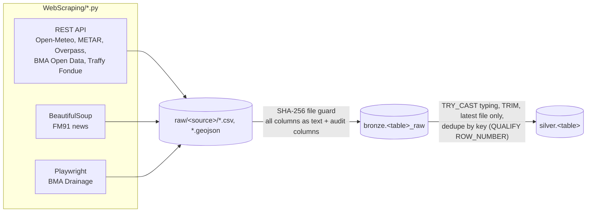

# Geospatial & Web Extraction (`DataEngineering/WebScraping`)

This directory contains the web extraction modules that harvest external datasets which contextualize urban traffic flow in Bangkok, and the loader that brings them into the lakehouse (Bronze → Silver).

All external sources cover **25–31 August 2026** (the CCTV dataset week). Each scraper keeps its own settings (date range, URLs, output path) at the top of the file.

---

## 🌐 Scraped Websites & Methods

| Script | Website | Method | Data |
| :--- | :--- | :--- | :--- |
| `sun_times.py` | archive-api.open-meteo.com | REST API | Daily sunrise / sunset times in Bangkok |
| `open_meteo.py` | archive-api.open-meteo.com | REST API | Hourly rain (mm), temperature, humidity, wind, cloud at 9 points across Bangkok |
| `metar.py` | mesonet.agron.iastate.edu (Iowa State Mesonet) | REST API | METAR airport reports (Don Mueang VTBD, Suvarnabhumi VTBS): weather codes (rain, heavy rain, thunderstorm), visibility, wind, cloud |
| `osm_overpass.py` | overpass-api.de (OpenStreetMap) | REST API | POIs (schools, hospitals, malls, markets), bus stops, BTS/MRT stations, footbridges, traffic signals, major roads with lane counts |
| `bma_open_data.py` | data.bangkok.go.th, cpudgiportal.bangkok.go.th | REST API | Population by district, district boundaries (GeoJSON), hawker & street-vendor zones |
| `traffy_fondue.py` | publicapi.traffy.in.th | REST API | Citizen complaints: text, coordinates, time, status, before/after photos (1,000 per page, paged with `offset`) |
| `fm91_news.py` | fm91bkk.com (FM91 Traffic Radio) | BeautifulSoup | Traffic, accident and flood news per article with date/time; road and intersection names extracted from the text |
| `bma_drainage.py` | weather.bangkok.go.th (BMA Drainage and Sewerage Dept.) | Playwright | Hourly rain per gauge station (all districts), road flood levels, canal water levels |
| `build_rail_geojson.py` | overpass-api.de (OpenStreetMap) | REST API | BTS / MRT / ARL / SRT line alignments and stations (see below) |

**Why Playwright for `bma_drainage.py`:** the historical data is only available through interactive search forms. The browser picks a date and time, submits the form, expands the paginated result table and reads every row — one hour of data per search (168 searches per system for the week).

> Sunrise and sunset times come from Open-Meteo instead of timeanddate.com, whose pages state that scripts and programs that download content are not allowed without permission.

---

## 🚀 Setup & Run

Install everything from the **Quickstart & Setup** section of the root [`README.md`](../../README.md), then run the whole pipeline (scrape → Bronze → Silver):

```bash
python DataEngineering/lakehouse_pipeline.py --scrape
```

| Flag | Effect |
| :--- | :--- |
| `--scrape` | Run the scrapers whose raw files are missing, then ingest |
| `--rescrape` | Re-run every scraper even if raw files exist |
| `--force` | Re-ingest raw files into Bronze even if the same file was loaded before |
| `--reset` | Delete and rebuild the whole lakehouse |

Run a single scraper (add `--force` to overwrite its raw files):

```bash
python DataEngineering/WebScraping/fm91_news.py
```

```bash
python DataEngineering/WebScraping/bma_drainage.py --only rain,flood
```

Approximate run time of a full scrape: 30–60 minutes (FM91 reads ~380 article pages; BMA Drainage performs one search per hour of data, and one search per canal for canal levels). Playwright uses the installed Microsoft Edge (`channel="msedge"`) and falls back to Playwright's Chromium.

---

## 🏗️ Pipeline



- **Raw (`raw/<source>/`)**: files written by the scrapers (ignored by git, reproducible by running the scrapers).
- **Bronze (`bronze.<table>_raw`)**: every column kept as text, plus `source_file`, `source_row_number`, `file_sha256`, `ingested_at`. A file whose SHA-256 is already loaded is skipped.
- **Silver (`silver.<table>`)**: typed columns (same names and order as the scraped files), built from the most recently ingested file, deduplicated by key. The `รวม` (total) row is removed from district population.

| Silver table | Raw file | Key | Rows (Aug 25–31) |
| :--- | :--- | :--- | ---: |
| `silver.sun_times` | `sun_times/sun_times_daily.csv` | date | 7 |
| `silver.weather_hourly_points` | `open_meteo/weather_hourly_points.csv` | point, datetime | 1,512 |
| `silver.weather_hourly_bangkok` | `open_meteo/weather_hourly_bangkok.csv` | datetime | 168 |
| `silver.metar_observations` | `metar/metar_hourly.csv` | station, datetime | 672 |
| `silver.osm_poi` | `openstreetmap/osm_poi.csv` | category, osm_type, osm_id | ~12,400 |
| `silver.osm_roads` | `openstreetmap/osm_roads.csv` | osm_id | ~19,600 |
| `silver.district_population` | `bma_open_data/bma_population_district.csv` | district_name | 50 |
| `silver.district_stats` | `bma_open_data/bma_district_stats.csv` | DISTRICT_CODE | 50 |
| `silver.district_boundaries` | `bma_open_data/bma_districts.geojson` | DISTRICT_CODE | 50 |
| `silver.hawker_zones` | `bma_open_data/bma_hawker_zones.csv` | id | 46 |
| `silver.traffy_complaints` | `traffy_fondue/traffy_fondue.csv` | ticket_id | 7,247 |
| `silver.fm91_news` | `fm91_news/fm91_news.csv` | article_id | ~376 |
| `silver.drainage_rain_hourly` | `bma_drainage/dds_rain_hourly.csv` | station_code, datetime | ~21,700 |
| `silver.drainage_flood_hourly` | `bma_drainage/dds_flood_hourly.csv` | station_code, station, datetime | ~18,500 |
| `silver.drainage_canal_level` | `bma_drainage/dds_canal_level.csv` | station_code, datetime | ~3,800 |
| `silver.drainage_stations` | `bma_drainage/dds_stations.csv` | system, station_code | 440 |

OSM and BMA counts change slightly over time because those sources reflect the current state of the map / catalogue.

---

## 📋 Silver Columns

All times are Bangkok local time.

### `silver.sun_times`
- `date` — calendar date
- `sunrise` — sunrise time
- `sunset` — sunset time
- `daylight_hours` — daylight length in hours

### `silver.weather_hourly_points`
- `point` — sampling point (center, north, northeast, east, southeast, south, southwest, west, northwest)
- `latitude`, `longitude` — point coordinates
- `datetime` — hour
- `precipitation` — total precipitation (mm)
- `rain` — rain (mm)
- `temperature_2m` — air temperature at 2 m (°C)
- `relative_humidity_2m` — relative humidity (%)
- `cloud_cover` — cloud cover (%)
- `weather_code` — WMO weather code (1–3 cloudy, 51/53/55 drizzle, 61/63/65 rain light/moderate/heavy)
- `wind_speed_10m` — wind speed at 10 m (km/h)
- `is_day` — 1 = daytime
- `is_raining` — 1 = precipitation ≥ 0.1 mm
- `rain_level` — no_rain (< 0.1), light (0.1–2.5), moderate (2.5–7.6), heavy (> 7.6 mm/h)

### `silver.weather_hourly_bangkok`
- `datetime` — hour
- `precipitation_mean` — mean precipitation of the 9 points (mm)
- `precipitation_max` — max precipitation of the 9 points (mm)
- `pct_points_raining` — share of points with rain (0–1)
- `temperature_2m` — mean temperature (°C)
- `relative_humidity_2m` — mean humidity (%)
- `cloud_cover` — mean cloud cover (%)

### `silver.metar_observations`
- `station` — ICAO code (VTBD Don Mueang, VTBS Suvarnabhumi)
- `station_name` — airport name
- `latitude`, `longitude` — airport coordinates
- `datetime` — report time
- `temp_c` — temperature (°C)
- `rh` — relative humidity (%)
- `wind_kt` — wind speed (knots)
- `visibility_km` — visibility (km)
- `sky_cover` — lowest cloud layer (FEW, SCT, BKN, OVC)
- `wxcodes` — present weather codes (-RA, RA, +RA, -TSRA, +TSRA, VCSH, ...)
- `metar` — full METAR report text
- `is_rain` — 1 = code contains RA
- `is_heavy_rain` — 1 = code contains + (heavy)
- `is_thunderstorm` — 1 = code contains TS
- `is_shower` — 1 = code contains SH

### `silver.osm_poi`
- `category` — school, hospital, mall, market, bus_stop, rail_station, footbridge, traffic_signals
- `osm_type` — OSM element type (node / way / relation)
- `osm_id` — OSM element id
- `name` — name (Thai)
- `name_en` — name (English)
- `network` — network / lines served
- `latitude`, `longitude` — coordinates (center for ways)

### `silver.osm_roads`
- `osm_id` — OSM way id of the road segment
- `road_name` — road name (Thai)
- `road_name_en` — road name (English)
- `highway` — road class (motorway, trunk, primary, secondary, tertiary)
- `lanes` — number of lanes (empty when not mapped)
- `oneway` — yes / no
- `maxspeed` — speed limit (km/h)
- `ref` — highway number
- `latitude`, `longitude` — segment center

### `silver.district_population`
- `no` — row number in the source
- `district_name` — district (Thai)
- `population` — total population
- `male` — male population
- `female` — female population

### `silver.district_stats`
- `DISTRICT_CODE` — district code
- `district_name` — district (Thai)
- `DISTRICT_NAME_E` — district (English)
- `area_km2` — area (km², from the boundary polygon)
- `population` — total population
- `pop_density_per_km2` — people per km²

### `silver.district_boundaries`
- `OBJECTID` — GIS object id
- `DISTRICT_CODE` — district code
- `DISTRICT_NAME_T` — district (Thai)
- `DISTRICT_NAME_E` — district (English)
- `CHANGWAT_CODE` — province code
- `CHANGWAT_NAME_T` — province (Thai)
- `CHANGWAT_NAME_E` — province (English)
- `SHAPE.AREA` — area (m²)
- `SHAPE.LEN` — perimeter (m)
- `geometry` — boundary polygon as GeoJSON text (WGS84)

### `silver.hawker_zones`
- `id` — row id
- `AFiscalYeal` — fiscal year (Buddhist Era)
- `AreaDist` — district
- `AreaName` — location / road of the zone
- `num` — number of vendors
- `Status` — status (permitted zone)
- `Food_vendors` — number of food vendors
- `Grease_trap_ installers` — vendors with grease traps
- `latitude`, `longitude` — coordinates
- `remark` — remarks

### `silver.traffy_complaints`
- `ticket_id` — complaint id
- `timestamp` — time reported
- `type` — problem type (empty: the API returns it blank)
- `description` — complaint text
- `address` — address of the location
- `district` — district (from the address)
- `org` — responsible agency
- `state` — latest status
- `star` — satisfaction rating (1–5)
- `count_reopen` — times reopened
- `latitude`, `longitude` — coordinates
- `photo_url` — photo before fixing
- `after_photo` — photo after fixing
- `note` — agency reply
- `last_activity` — last status update
- `resolve_hours` — hours to resolve (finished tickets only)
- `is_flood` — 1 = about flooding
- `is_road` — 1 = about roads
- `is_traffic` — 1 = about traffic
- `is_sidewalk` — 1 = about sidewalks / street vendors

### `silver.fm91_news`
- `article_id` — article number on fm91bkk.com
- `datetime` — publication time
- `category` — news category (ข่าวจราจร = traffic, สังคม, ภูมิภาค, ...)
- `title` — headline
- `body` — article text
- `url` — article link
- `is_traffic_category` — 1 = traffic news category
- `mentions_accident` — 1 = mentions an accident
- `mentions_flood` — 1 = mentions flooding
- `mentions_rain` — 1 = mentions rain / storm
- `mentions_congestion` — 1 = mentions congestion
- `bangkok_related` — 1 = mentions Bangkok
- `roads` — road names found in the text
- `intersections` — intersection names found in the text

### `silver.drainage_rain_hourly`
- `station_code` — rain gauge code (RF.xxx.nn)
- `district` — district
- `station` — station name
- `datetime` — start of the hour (14:00 = rain from 14:00 to 15:00)
- `rain_mm` — rainfall in that hour (mm)

### `silver.drainage_flood_hourly`
- `station_code` — road / tunnel flood sensor code (FL.xxx.nn road, TN.xxx.nn tunnel)
- `road` — road name
- `station` — sensor location (tunnel sensors share one code for inbound and outbound, so use code + station)
- `datetime` — reading time
- `flood_cm` — water depth on the road (cm, 0 = no flooding)

### `silver.drainage_canal_level`
- `station_code` — canal gauge code (WL.xxx.nn)
- `canal` — canal name
- `station` — gauge location
- `datetime` — reading time (every 12 hours)
- `level_inside_m` — water level inside the gate (m above MSL)
- `level_outside_m` — water level outside the gate (m above MSL)
- `level_river_m` — river level (m above MSL)

### `silver.drainage_stations`
- `system` — rain = rain gauge, water = canal gauge
- `station_code` — station code
- `station` — station name
- `district_name` — district
- `latitude`, `longitude` — coordinates

---

## 🚆 `build_rail_geojson.py`
Queries the **OpenStreetMap Overpass API** to extract real-world track alignments and station node geometries for all rapid mass transit lines in Greater Bangkok:
- **BTS Sukhumvit Line** (`#65B724`)
- **BTS Silom Line** (`#02817D`)
- **BTS Gold Line** (`#A58704`)
- **MRT Blue Line** (`#1E398D`)
- **MRT Purple Line** (`#893B90`)
- **MRT Yellow Line** (`#FFD400`)
- **MRT Pink Line** (`#E76589`)
- **Airport Rail Link** (`#91278F`)
- **SRT Dark Red Line** (`#B81D24`)
- **SRT Light Red Line** (`#E83D3D`)

#### Operational Workflow:
1. **Route Query**: Downloads transit relations categorized as `subway`, `light_rail`, `monorail`, or `train` within the Greater Bangkok bounding box (`13.45°N - 14.05°N, 100.25°E - 100.95°E`).
2. **Station Query & Distance Snapping**: Retrieves railway and public transit station nodes, filters by network operator, and maps each station to its corresponding rail line if within a 200-meter threshold.
3. **Interchange Consolidation**: Merges interchange stations sharing identical names within 300 meters into unified transfer hubs.
4. **GeoJSON Generation**: Outputs an optimized GeoJSON feature collection directly consumable by web mapping engines.

#### Usage:
```bash
python DataEngineering/WebScraping/build_rail_geojson.py
```
`DataEngineering/build_rail_geojson.py` is a backward-compatible proxy that runs this same script.

#### Output:
- Saved to: `Apps/Camera-Map/static/bangkok_rail.geojson`

### Output Schema

The generated `bangkok_rail.geojson` file is formatted as a standard GeoJSON `FeatureCollection` with two feature categories:

#### 1. Transit Lines (`properties.kind == "line"`)
- `key`: Unique line identifier (e.g., `bts-sukhumvit`, `mrt-blue`)
- `system`: Mass transit operator (`BTS`, `MRT`, `ARL` or `SRT`)
- `name_th`: Official Thai line name (e.g., `บีทีเอส สายสุขุมวิท`)
- `name_en`: English line name (e.g., `BTS Sukhumvit Line`)
- `colour`: Official hex brand color (e.g., `#65B724`)
- `geometry`: `MultiLineString` containing geographic coordinates `[longitude, latitude]`

#### 2. Station Nodes (`properties.kind == "station"`)
- `name_th`: Official Thai station name (e.g., `สยาม`, `อโศก`)
- `name_en`: English station name (e.g., `Siam`, `Asok`)
- `lines`: Array of line keys connected at this station
- `geometry`: `Point` coordinate `[longitude, latitude]`

---

## 📜 Data Licenses
- OpenStreetMap data © OpenStreetMap contributors (ODbL).
- Open-Meteo data: CC BY 4.0.
- METAR: Iowa Environmental Mesonet, Iowa State University.
- BMA Open Data, BMA Drainage and Sewerage Department, Traffy Fondue, FM91: public data from the respective agencies; used for non-commercial education.
