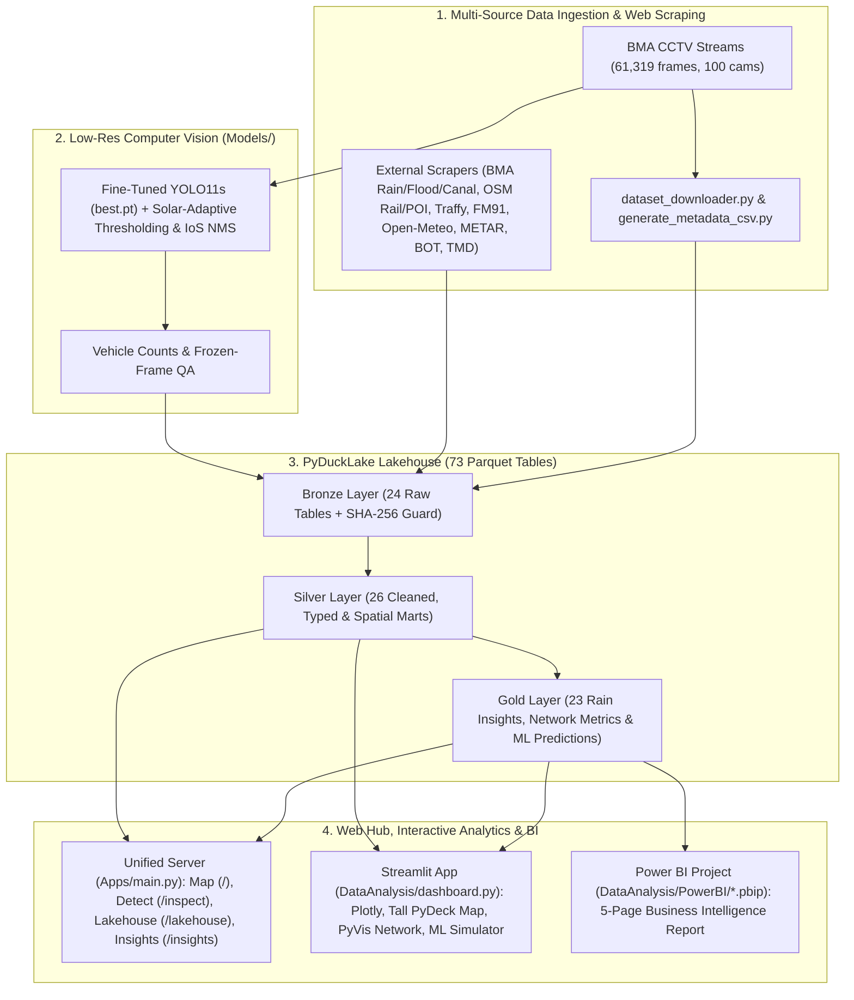

# Bangkok CCTV Image Analysis & Urban Mobility Intelligence Platform

An end-to-end **Data Engineering, Computer Vision, Machine Learning, and Business Intelligence** platform analyzing traffic dynamics across **100 Bangkok Metropolitan Administration (BMA) CCTV cameras** (`61,319` frames, 25–31 August 2026), correlated with **BMA rain/flood gauges**, **188 rapid transit stations (BTS/MRT/ARL/SRT)**, **Traffy Fondue citizen complaints**, **FM91 traffic news**, **Open-Meteo / METAR weather**, and **OpenStreetMap urban infrastructure**.

---

## Key Analytical Insights & Findings

- **Citywide Rain Effect (`-21.0%` Motorcycles, `-5.4%` Total):** Comparing wet hours ($\ge 1\text{ mm/h}$) against each camera's dry baseline at the **same clock hour and weekday/weekend type** (`293` wet camera-hours across `94` cameras), visible motorcycles drop **`-21.0%`** (95% CI `-27.4%` to `-14.4%`; rush hours **`-30.5%`**), while passenger cars stay near zero (`-2.2%`, CI `-6.4%` to `+2.2%`).
- **Hidden Modal Shift (`+12.6 pts` Cars in Localized Rain):** In a **15-hour same-hour natural experiment** comparing rained-on cameras against dry neighbor cameras within $\le 3\text{ km}$ (`172` pairs), cars read **`+12.59 percentage points` higher** (CI `+2.2` to `+20.7`), pointing toward a localized shift from two-wheelers to four-wheelers even when citywide two-wheeler trips decline.
- **Weekday vs. Weekend Timing Confounder (`16:00–17:00` Overlap):** Weekday rain fell across `69` camera-hours spanning **only 8 clock hours (16:00–20:00)**, whereas weekend rain fell across `224` camera-hours (**12:00–17:00**), overlapping at only `16:00` and `17:00`. Subgroup comparisons without controlling for clock hour are misleading.
- **Disproved Sheltering & Flood Assumptions:** Stationary motorcycles near footbridges/expressways changed negligibly (`2.5%` dry vs. `2.8%` wet; sidewalk parking rather than main-lane blockages), and all `13` flood readings $\ge 5\text{ cm}$ (`FL.RTW.02` Phetchaburi Rd) showed no vehicle count rise at road-matched cameras `250` & `256`.
- **Empirical Correlations & Supervised ML:** Proximity to BTS/MRT (`rail_dist_m`) correlates strongest with density (`motorcycle r = -0.2567`, `total r = -0.1992`). Supervised `RandomForest` / `HistGradientBoosting` models predict held-out weekend traffic density at **$R^2 = 0.6423$** (without baseline) and **$R^2 = 0.8299$** (with baseline), with `rain_mm` ranking as the #1 weather permutation driver for motorcycle predictions (`R² = 0.7536`).
- **Data Quality Audit (`Aug 27 07:00` Blank-Frame Outage):** `71 / 73` snapshots at `2026-08-27 07:21–07:26` (and similar 07:00–08:00 subsets across Aug 26–31) were `1,402–1,404 byte` solid-white BMA server outage placeholders rather than YOLO misdetections.

---

## System Architecture (PyDuckLake Bronze → Silver → Gold)



---

## Complete Repository Structure

```text
Bangkok-CCTV-Image-Analysis-DSDE/
├── Apps/                                  # Unified Multi-App Web Server (:8080)
│   ├── main.py                            # Combined HTTP server (/ , /inspect, /lakehouse, /insights)
│   ├── README.md                          # Web applications & API documentation
│   ├── Camera-Map/                        # Interactive Leaflet GIS map (/)
│   ├── Detection-Classification/          # YOLO11s single & 16-grid control room (/inspect)
│   ├── Lakehouse-Viewer/                  # PyDuckLake catalog browser & SQL workbench (/lakehouse)
│   └── Traffic-Insights/                  # Rain telemetry & mobility findings dashboard (/insights)
├── DataEngineering/                       # ETL, Labeling, Quality & PyDuckLake Pipeline
│   ├── README.md                          # Lakehouse Bronze/Silver/Gold schema guide
│   ├── lakehouse_pipeline.py              # PyDuckLake orchestrator & shared query_lake / write_lake_table API
│   ├── dataset_downloader.py              # Google Drive dataset retriever
│   ├── generate_metadata_csv.py           # Master 61,319-frame metadata catalog generator
│   ├── build_rail_geojson.py              # Proxy to OSM rail geometry extractor
│   ├── cctv_images_metadata.csv           # Image metadata catalog (init source)
│   ├── vehicle_counts.csv                 # YOLO11s batch detection counts (init source)
│   ├── lakehouse/                         # bkk_cctv.ducklake catalog & Parquet partitions (gitignored)
│   ├── quality/                           # Frozen-frame QA detector (find_frozen_frames.py)
│   ├── labeling/                          # Human review web UI & dataset merge utilities
│   ├── reviews/                           # Reviewed human box labels (train/test queues)
│   ├── train_set/ & test_set/             # YOLO fine-tuning & evaluation sets
│   └── WebScraping/                       # 11 scrapers + external_lakehouse.py + raw/ caches
├── Models/                                # Computer Vision & Fine-Tuning
│   ├── README.md                          # YOLO architecture & CIF adaptation guide
│   ├── detector.py                        # YOLOVehicleDetector (IoS suppression, solar threshold)
│   ├── model_registry.py                  # Weight resolution (best.pt / yolov8n.pt)
│   ├── pipeline.py                        # Batch inference runner skipping frozen frames
│   ├── training/                          # train_pipeline.py & training docs
│   └── weights/                           # Committed fine-tuned best.pt + metrics
├── DataAnalysis/                          # Analytics, ML, NetworkX & BI Reporting
│   ├── README.md                          # Analytics, Streamlit & Power BI entry guide
│   ├── dashboard.py                       # 7-tab Streamlit dashboard (PyDuckLake + Plotly + PyDeck + PyVis + ML)
│   ├── rain_insight.ipynb                 # Summary notebook
│   ├── requirements-dashboard.txt         # Dashboard & ML dependencies
│   ├── rain/                              # Modular analysis, ML, & PyVis network scripts
│   │   ├── common.py, prepare.py, effects.py, shelter.py, traffy.py, policy.py
│   │   ├── stratified.py, recount.py, run_all.py, figures.py
│   │   ├── ml_model.py                    # Supervised Regression, Surge Classification & Correlations
│   │   └── network_viz.py                 # Sparse k-NN NetworkX + PyVis community graph
│   ├── PowerBI/                           # 5-page Power BI Project (.pbip + TMDL + PBIR) & guide
│   ├── output/                            # Exported Gold CSV marts (for Power BI / init)
│   ├── figures/                           # Static verification plots (*.png)
│   └── data/counts_v2.csv                 # Recount dataset bootstrapped to silver.counts_v2
├── dataset/                               # BMA 100_cameras imagery (downloaded automatically, gitignored)
├── tests/                                 # Unit & integration test suites (rain, models, labeling, webscraping)
├── GEMINI.md                              # Workspace Git conventions
└── README.md                              # Project documentation (this file)
```

---

## Quickstart & Launch Commands

### 1. Environment Setup
```bash
conda create -n dsde python=3.11 -y
conda activate dsde
pip install ultralytics opencv-python-headless pillow requests gdown beautifulsoup4 lxml selenium playwright duckdb pyducklake pytz
pip install -r DataAnalysis/requirements-dashboard.txt
python -m playwright install chromium
```

### 2. Initialize PyDuckLake & Run Analytics / ML Pipelines
```bash
# 1. Build Bronze -> Silver -> Gold lakehouse from local raw CSVs (add --scrape to re-fetch missing sources)
python DataEngineering/lakehouse_pipeline.py

# 2. Recompute Rain Insights & ML Prediction tables in Gold (plus Power BI CSV exports)
python -m DataAnalysis.rain.run_all
python DataAnalysis/rain/ml_model.py
```

### 3. Launch Applications & Dashboards
| Interface | Command | URL / Access |
| :--- | :--- | :--- |
| **Unified Web Hub** | `python Apps/main.py` | [`/`](http://localhost:8080/) Map · [`/inspect`](http://localhost:8080/inspect) YOLO · [`/lakehouse`](http://localhost:8080/lakehouse) SQL · [`/insights`](http://localhost:8080/insights) Rain Story |
| **Insights-Only Mode** | `python Apps/main.py --insights-only` | [`http://localhost:8080/insights`](http://localhost:8080/insights) (no GPU/CV startup needed) |
| **Streamlit Analytics** | `streamlit run DataAnalysis/dashboard.py` | [`http://localhost:8501`](http://localhost:8501) (Plotly, Tall PyDeck Map, PyVis Network, ML Simulator) |
| **Power BI Report** | Open `DataAnalysis/PowerBI/Bangkok_Rain_Traffic_Story.pbip` | Power BI Desktop ([setup guide](DataAnalysis/PowerBI/README.md)) |

### 4. Run Automated Tests
```bash
python -m unittest discover -s tests/rain -t . -v
```

---

## Tech Stack
- **Computer Vision:** Ultralytics YOLO11s, PyTorch, OpenCV, Pillow
- **Data Engineering & Lakehouse:** PyDuckLake, DuckDB, Apache Parquet, Python `urllib`/`csv`/`json`, Gdown
- **Web Scraping:** Playwright, Selenium, BeautifulSoup4 (`lxml`), OpenStreetMap Overpass API, Open-Meteo, IEM METAR, Traffy Fondue API, BMA Open Data & Drainage
- **Analytics, ML & Networks:** Pandas, NumPy, Scikit-Learn (`HistGradientBoosting`, `RandomForest`, `Ridge`, `DBSCAN`), NetworkX, SciPy
- **Visualization & BI:** Streamlit, Plotly, PyDeck, PyVis, Leaflet.js, Matplotlib, Microsoft Power BI (`.pbip` / TMDL / PBIR)

---

## Attribution & Licenses
- **CCTV Imagery & Drainage / Open Data:** Bangkok Metropolitan Administration (BMA).
- **Map Geometries & Transit Routes:** © [OpenStreetMap](https://www.openstreetmap.org/) contributors ([ODbL](https://opendatacommons.org/licenses/odbl/)).
- **Meteorological Data:** Open-Meteo (CC BY 4.0) & Iowa Environmental Mesonet (METAR).
