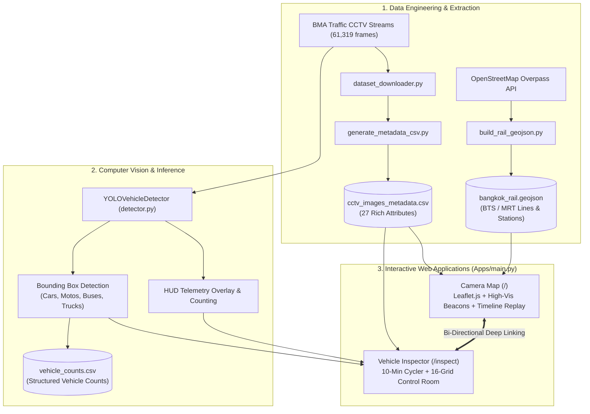

# Bangkok CCTV Image Analysis & Traffic Intelligence Platform

An end-to-end spatial-temporal traffic analytics and computer vision platform designed to monitor, detect, and analyze urban vehicular movement across Bangkok, Thailand. The system processes high-volume visual feeds from the Bangkok Metropolitan Administration (BMA) traffic camera network, performs automated vehicle detection, and correlates traffic density with geographic infrastructure and mass transit networks.

---

## 📌 Project Overview

Urban traffic congestion in Bangkok is influenced by complex spatial-temporal dynamics, road topography, and mass transit connectivity. This project provides a unified data science and data engineering platform that:
- **Catalogs & Ingests**: Standardizes over 61,000 CCTV frames across 100 camera locations with microsecond-level temporal attribution and spatial coordinates.
- **Extracts Geospatial Context**: Integrates Bangkok's complete BTS and MRT mass transit network geometries and station nodes via OpenStreetMap Overpass queries.
- **Deep Learning Vision**: Deploys lightweight YOLO object detection adapted for low-resolution surveillance footage (CIF $352 \times 288$) to classify and count vehicles across four key categories: *Cars*, *Motorcycles*, *Buses*, and *Heavy Trucks*.
- **Interactive Command Center**: Hosts a high-performance web platform uniting an interactive geospatial camera map with a multi-camera control room and fine-grained frame inspector.



---

## 📁 Repository Structure

```text
Bangkok-CCTV-Image-Analysis-DSDE/
├── Apps/                                # Unified Web Applications
│   ├── main.py                          # Integrated web server (Map at /, Detect at /inspect)
│   ├── README.md                        # Application suite documentation
│   ├── Camera-Map/                      # Interactive GIS map application
│   │   ├── app.py                       # Standalone map backend & data endpoints
│   │   ├── static/
│   │   │   ├── bangkok_rail.geojson     # Generated BTS/MRT line and station geometries
│   │   │   └── bts.png, mrt.png         # Transit branding assets
│   │   └── templates/index.html         # Leaflet GIS interface with custom CCTV beacons
│   └── Detection-Classification/        # Detection dashboard & control room
│       ├── app.py                       # Detection REST API & frame cycler service
│       └── templates/index.html         # Single inspector & 16-camera matrix dashboard
├── DataEngineering/                     # Data Ingestion, Extraction & Schemas
│   ├── README.md                        # Data engineering documentation
│   ├── dataset_downloader.py            # Automated dataset fetcher
│   ├── generate_metadata_csv.py         # CCTV metadata catalog generator
│   ├── build_rail_geojson.py            # Backward-compatible proxy to rail extractor
│   ├── cctv_images_metadata.csv         # Full catalog of 61,319 images with 27 attributes
│   └── WebScraping/                     # Web extraction modules
│       ├── README.md                    # Web extraction documentation
│       ├── build_rail_geojson.py        # OpenStreetMap Overpass extractor for transit
│       ├── sun_times.py, open_meteo.py, metar.py, osm_overpass.py, bma_open_data.py,
│       │   traffy_fondue.py, fm91_news.py, tmd_weekly_summary.py, bot_holidays.py,
│       │   bma_drainage.py              # External source scrapers
│       └── external_lakehouse.py        # Bronze -> Silver loader for scraped sources
├── Models/                              # Computer Vision & Inference Pipelines
│   ├── README.md                        # Modeling documentation
│   ├── detector.py                      # YOLOVehicleDetector class (inference & telemetry)
│   ├── pipeline.py                      # Batch feature extraction pipeline
│   ├── test_detection.py                # Standalone verification script
│   ├── training_prep.py                 # Dataset bootstrapping & pseudo-labeling
│   ├── resolution_adaptation_guide.md   # Architectural guide for low-resolution CIF imagery
│   └── weights/                         # Model weight storage
├── DataAnalysis/                        # Exploratory data analysis notebooks & statistical scripts
└── dataset/                             # Local dataset storage (ignored from version control)
    └── 100_cameras/
        ├── cctv_info.csv                # Camera locations, coordinates, and road descriptions
        └── cctv_images/                 # Captured frames (Aug 25 - Aug 31, 2026)
```

---

## 🚀 Quickstart & Setup

### 1. Prerequisites & Environment Setup
Clone the repository and configure a Python 3.10+ environment:
```bash
git clone https://github.com/MaxzyMVT/Bangkok-CCTV-Image-Analysis-DSDE.git
cd Bangkok-CCTV-Image-Analysis-DSDE

# Create and activate environment
conda create -n dsde python=3.11 -y
conda activate dsde

# Install required dependencies
pip install ultralytics opencv-python-headless pillow requests gdown beautifulsoup4 lxml selenium pandas playwright duckdb pyducklake pytz
python -m playwright install chromium
```

### 2. Launch the Unified Web Application
Start both the **Camera Map** and the **Vehicle Detection Dashboard** using the master application runner:
```bash
python Apps/main.py
```
By default, the server runs on port `8080`. Specify a custom port with `--port`:
```bash
python Apps/main.py --port 9000
```

| Application View | URL Route | Description |
| :--- | :--- | :--- |
| **Camera Map** | [`http://localhost:8080/`](http://localhost:8080/) | Geospatial overview of all 100 cameras, BTS/MRT routes, and frame timeline replay |
| **Vehicle Inspector** | [`http://localhost:8080/inspect`](http://localhost:8080/inspect) | YOLO inference, vehicle telemetry HUD, 10-minute snapshot cycler, and 16-camera matrix |

> [!NOTE]
> On the initial launch, if the CCTV image archive is not found locally, `dataset_downloader.py` automatically fetches and extracts the dataset files into `dataset/100_cameras/`.

### 3. Run the Web Scraping & Lakehouse Pipeline
Scrape all external sources (Aug 25–31, 2026) and load them into the lakehouse (Bronze → Silver) in one command:
```bash
python DataEngineering/lakehouse_pipeline.py --scrape
```
Scrapers only run for raw files that are missing. Re-scrape every source with `--rescrape`, rebuild the lakehouse from scratch with `--reset`. The full first run takes about 2 hours 15 minutes, mostly BMA Drainage canal levels and the Overpass API. See [`DataEngineering/WebScraping/README.md`](DataEngineering/WebScraping/README.md) for the sources, methods, and output columns.

---

## 🗺️ Interactive Camera Map (`/`)

The geospatial platform visualizes all 100 BMA traffic cameras across Bangkok with real-time frame inspection:

* **High-Visibility CCTV Beacons**: Custom multi-layer beacons featuring inline CCTV camera glyphs. Engineered with high-contrast dual borders (midnight outer ring + bright inner rim + ambient drop shadow) ensuring crisp visibility across all basemaps:
  - **Electric Cyan Beacon**: Camera online with captured historical frames.
  - **Vibrant Amber Beacon with Sonar Pulse**: Active selected camera with animated radar waves expanding from the ground coordinate.
  - **Slate Gray Beacon with Strike**: Camera location recorded without captured still images.
* **Multi-Basemap Switcher**: Switch instantly between **Dark**, **Streets**, **Minimal** (clean OpenFreeMap vector style), and **Satellite** imagery.
* **Mass Transit Rail Overlay (BTS / MRT)**: Displays real alignments and station stops for BTS Sukhumvit, Silom, Gold Line, and MRT Blue, Purple, Yellow, and Pink lines in official transit colors. Stations dynamically scale from zoom level 13 with Thai names appearing at zoom 15.
* **Historical Frame Replay**: Built-in timeline player inside the camera popup. Step through frames (`⏮` previous / `▶` play / `⏭` next), scrub through daily timelines, or select specific observation dates.
* **Bi-Directional Deep Linking**:
  - Click any camera frame or **"Open in Detect"** (`เปิดใน Detect`) to immediately launch that exact frame in the detection inspector.
  - In Detect, clicking **"View Camera on Map"** (`ดูตำแหน่งกล้องบนแผนที่`) flies the map directly to that camera marker with the matching timestamp.

---

## 🚗 Vehicle Detection & Control Room (`/inspect`)

The computer vision platform provides interactive inference and telemetry:

1. **Single Camera Inspector**:
   - Runs deep learning inference to identify, localize, and count **Cars**, **Motorcycles**, **Buses**, and **Trucks**.
   - Displays a live HUD overlay detailing vehicle breakdown, detection confidence, timestamp, and camera identifiers.
   - **Keyboard Navigation**:
     - `←` / `A`: Step backward by 10 minutes.
     - `→` / `D`: Step forward by 10 minutes.
     - `Spacebar`: Toggle automatic timelapse slideshow playback.
     - `R`: Re-run YOLO detection on current frame.
   - **Continuous Auto-Detect**: Optional toggle to perform instant detection automatically as you advance through the timeline.

2. **16-Camera Control Room Matrix (4×4 Grid)**:
   - **Time Sequence Mode**: Inspect 16 sequential 10-minute intervals for a single camera (spanning 160 continuous minutes of traffic evolution).
   - **City-Wide Mode**: Monitor 16 distinct geographic intersections across Bangkok simultaneously at the same timestamp.
   - **Batch YOLO Inference**: Execute vehicle detection across all 16 tiles simultaneously with aggregate vehicle count summaries.
   - Click any camera tile to zoom directly into the Single Camera Inspector.

---

## 📊 Data Engineering & Metadata Catalog

The project processes and catalogs the BMA CCTV image dataset through reproducible extraction scripts:

### Metadata Catalog (`DataEngineering/cctv_images_metadata.csv`)
Generated by `DataEngineering/generate_metadata_csv.py`, indexing all **61,319 images** across 27 structured attributes:
* **Identification**: `image_id`, `camera_id`, `filename`, `relative_path`
* **Spatial Geometry**: `location_th`, `direction_th`, `location_en`, `location_detail_en`, `latitude`, `longitude`, `ip_address`
* **Temporal Attributes**: ISO `timestamp`, `date`, `time`, `year`, `month`, `day`, `day_of_week`, `is_weekend`, `hour`, `minute`, `second`, and categorized `time_period` (*Early Morning*, *Morning Rush*, *Midday*, *Evening Rush*, *Night*)
* **Image Specifications**: `width` (352), `height` (288), `aspect_ratio` (1.22), `file_size_bytes`

### Transit Geospatial Extraction (`DataEngineering/WebScraping/build_rail_geojson.py`)
Queries the OpenStreetMap Overpass API to download line geometries and station nodes for all Bangkok rapid transit routes, outputting `Apps/Camera-Map/static/bangkok_rail.geojson`.
```bash
python DataEngineering/WebScraping/build_rail_geojson.py
```

---

## 🧠 Low-Resolution Computer Vision Strategy

A key engineering challenge of municipal CCTV surveillance is video resolution: over 99% of Bangkok BMA traffic cameras output **CIF resolution ($352 \times 288$ pixels)**.

Standard object detection models trained on $640 \times 640$ datasets encounter severe degradation:
- Upscaling introduces bilinear interpolation blur.
- Small vehicles (motorcycles and distant sedans spanning only 10–15 pixels) vanish through successive pooling layers.

### Architectural Adaptations
Documented in detail in [`Models/resolution_adaptation_guide.md`](Models/resolution_adaptation_guide.md):
1. **Aspect-Ratio Preserved Native Input**: Model trained with rectangular inference (`rect=True`) at native resolution scales (`imgsz=384`) rather than square upscaling.
2. **P2 High-Resolution Feature Stride**: Integration of a stride-4 detection head to capture fine spatial details before semantic pooling.
3. **Pseudo-Labeling Pipeline**: Automated bootstrapping script (`Models/training_prep.py`) generating silver labels across the 61,000 Bangkok frames for iterative domain adaptation.

---

## 🛠️ Tech Stack

- **Computer Vision**: Ultralytics YOLO, OpenCV, NumPy, Pillow
- **Web Applications**: Python HTTP Server, Leaflet.js, OpenFreeMap, OpenStreetMap
- **Data Engineering**: Overpass API (OSM), Python standard library (`urllib`, `csv`, `json`), Gdown
- **Data Formats**: GeoJSON, CSV, JSON, JPEG

---

## 📄 License & Attribution

- **CCTV Imagery & Metadata**: Bangkok Metropolitan Administration (BMA).
- **Map Geometries & Transit Data**: © [OpenStreetMap](https://www.openstreetmap.org/) contributors, licensed under the [Open Database License (ODbL)](https://opendatacommons.org/licenses/odbl/).
- **Vector Map Tiles**: © [OpenFreeMap](https://openfreemap.org/) / OpenMapTiles.
